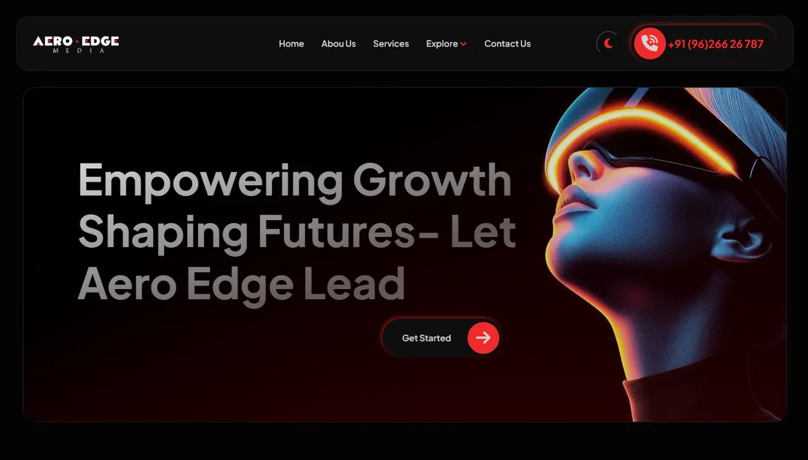

# Aero Edge Media — website (Django)



Company website for **Aero Edge Media**, a media agency, built on Django with a working contact form that emails the team.

- **Tech:** Python · Django · MySQL/SQLite · HTML · CSS · JavaScript
- **My role:** full-stack build, email setup and deployment on Hostinger (Passenger)
- **Status:** delivered during my internship at Aero Edge Media

## Run locally
```bash
pip install -r requirements.txt
cp .env.example .env        # set DJANGO_SECRET_KEY, EMAIL_HOST_PASSWORD, ...
python manage.py runserver
```
Secrets are read from environment variables and never committed.

---

Built by **Kaviyarasu K** — Full-Stack & App Developer, Coimbatore · [Portfolio](https://kaviyarasu-portfolio.pages.dev) · [LinkedIn](https://www.linkedin.com/in/kaviyarasu-kanthavel/)
